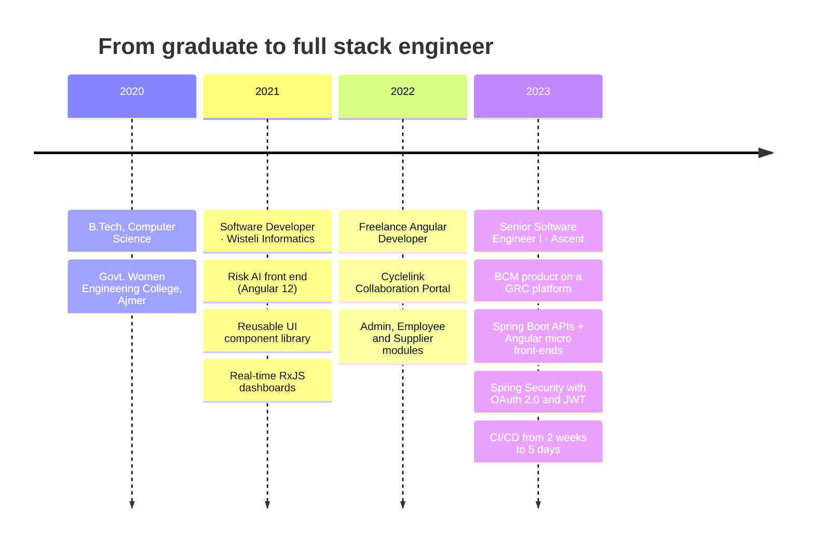

<p align="center">
  
</p>

<p align="center">
  <a href="https://github.com/yuktavyas14">
    
  </a>
</p>

<p align="center">
  <a href="https://linkedin.com/in/yukta-vyas-62273a186"></a>
  <a href="mailto:yuktavyas1234@gmail.com"></a>
  
  
</p>

<p align="center">
  
  
  
  
</p>

---

## 👩‍💻 About me

```yaml
# application.yml
developer:
  name: Yukta Vyas
  role: Senior Software Engineer I @ Ascent Business Technology
  experience: 3+ years
  domain: Business Continuity Management (BCM) · GRC
  backend:  [Java, Spring Boot, Spring Security, Spring Data JPA, Hibernate, Microservices]
  frontend: [Angular, TypeScript, RxJS, NgRx, Angular Material, PrimeNG]
  data:     [MySQL, PostgreSQL, MongoDB]
  devops:   [Docker, Jenkins, GitLab CI/CD, Maven]
  currently-learning: [Kafka, Kubernetes, AWS, Spring AI]
  status: open-to-full-stack-roles
```

I'm a **Full Stack Developer** who builds enterprise web applications end to end. I write **Spring Boot REST APIs and microservices** on the backend and fast, modular **Angular** UIs on the frontend. Today I build the **Business Continuity Management** product of an enterprise **GRC** platform, which helps organisations plan for and recover from disruptions.

---

## 🚀 Impact at a glance

<table align="center">
  <tr>
    <td align="center" width="25%"><h2>30%</h2><b>faster page loads</b><br/><sub>lazy loading, OnPush and bundle optimisation</sub></td>
    <td align="center" width="25%"><h2>2w → 5d</h2><b>release cycle</b><br/><sub>Jenkins + GitLab CI/CD automation</sub></td>
    <td align="center" width="25%"><h2>95%+</h2><b>test coverage</b><br/><sub>Jasmine/Karma frontend, plus JUnit/Mockito</sub></td>
    <td align="center" width="25%"><h2>~40%</h2><b>fewer merge conflicts</b><br/><sub>independently deployable micro front-ends</sub></td>
  </tr>
  <tr>
    <td align="center"><h2>~35%</h2><b>less repeated UI work</b><br/><sub>reusable Angular component library</sub></td>
    <td align="center"><h2>~20%</h2><b>faster rendering</b><br/><sub>memory leaks and cross-browser issues fixed</sub></td>
    <td align="center"><h2>3–5</h2><b>features per sprint</b><br/><sub>shipped to production, API to UI</sub></td>
    <td align="center"><h2>0</h2><b>critical rollbacks</b><br/><sub>across every release cycle</sub></td>
  </tr>
</table>

---

## 🧭 Career journey



---

## 🔬 Case studies

<details>
<summary><b>⚡ Making data-heavy risk dashboards 30% faster</b></summary>

- **Problem:** BCM and risk dashboards loaded slowly as the modules grew.
- **Fix:** Lazy-loaded feature modules, the OnPush change detection strategy, bundle size optimisation, and NgRx to remove redundant API calls.
- **Result:** **Up to 30% lower page load time** across production SPAs.

</details>

<details>
<summary><b>🚢 Cutting the release cycle from 2 weeks to 5 days</b></summary>

- **Problem:** Manual build and deployment steps slowed every release.
- **Fix:** Streamlined Jenkins and GitLab CI/CD pipelines that automatically build, test and deploy.
- **Result:** **Releases every 5 days instead of every 2 weeks**, with 3–5 features per sprint and zero critical rollbacks.

</details>

<details>
<summary><b>🧩 Micro front-ends for independent teams</b></summary>

- **Problem:** Several teams working in one large Angular codebase kept running into each other's changes.
- **Fix:** Reusable micro front-end modules that each team can build and deploy on its own.
- **Result:** **~40% fewer inter-team merge conflicts** and more team autonomy.

</details>

<details>
<summary><b>🔐 Securing compliance data</b></summary>

- **Problem:** GRC data is sensitive, and different roles must see different things.
- **Fix:** Role-based access control with Spring Security, OAuth 2.0 and JWT across all modules.
- **Result:** Consistent, secure access rules for every BCM workflow.

</details>

---

## 🛠️ Tech stack

<p align="center">
  
</p>

| Area | What I use |
|---|---|
| **Backend** | Java, Spring Boot, Spring MVC, Spring Security, Spring Data JPA, Hibernate, REST APIs, Microservices, Spring Cloud Gateway, Eureka |
| **Frontend** | Angular (12–20), TypeScript, RxJS, NgRx, Angular Material, PrimeNG, NG-Zorro, Bootstrap, SCSS |
| **Security** | Spring Security, OAuth 2.0, JWT, role-based access control |
| **Data** | MySQL, PostgreSQL, MongoDB |
| **DevOps** | Docker, Jenkins, GitLab CI/CD, Maven, Git |
| **Testing** | JUnit, Mockito, Jasmine, Karma |
| **AI-assisted dev** | GitHub Copilot, Augment Code, ChatGPT, Claude, OpenAI API, LangChain |

---

## 📌 Featured projects

<table>
  <tr>
    <td width="50%" valign="top">
      <h3><a href="https://github.com/yuktavyas14/ecommerce-microservices">🛒 E-Commerce Microservices</a></h3>
      <b>Microservices shopping platform</b><br/>
      User, Product and Order services behind a Spring Cloud Gateway with Eureka discovery, JWT authentication, a separate database for each service, and an Angular 20 storefront.<br/><br/>
      
      
      
      
      
    </td>
    <td width="50%" valign="top">
      <h3><a href="https://github.com/yuktavyas14/openai-chat-api">🤖 AI Chat API</a></h3>
      <b>Gen AI chat backend</b><br/>
      A GPT-4 chat API with two approaches: the OpenAI SDK called directly, and a LangChain prompt chain.<br/><br/><br/>
      
      
      
      
    </td>
  </tr>
  <tr>
    <td width="50%" valign="top">
      <h3><a href="https://github.com/yuktavyas14/fullstack-blog-app">📝 Blog Platform</a> <sub>(in progress)</sub></h3>
      <b>Full stack blogging app</b><br/>
      A Spring Boot REST API with MySQL and an Angular UI.<br/><br/>
      
      
      
    </td>
    <td width="50%" valign="top">
      <h3><a href="https://github.com/yuktavyas14/employee-management-system">👥 Employee Management</a></h3>
      <b>CRUD management system</b><br/>
      Employee records management built in Java.<br/><br/>
      
    </td>
  </tr>
</table>

---

## 🧱 How I build

- 🧪 **Tested by default.** I aim for high coverage, so releases don't need rollbacks.
- 🔒 **Secure from day one.** Roles and authentication are designed in, not bolted on.
- ⚡ **Performance is a feature.** I measure, then optimise lazy loading, change detection and queries.
- 🧩 **Reusable over repeated.** Shared components and modules save every team time.
- 🤖 **AI as a co-pilot.** I use Copilot and Augment for speed, and I own the quality.

---

## 🌱 Currently levelling up

<p align="center">
  
  
  
  
  
</p>

---

## 📊 GitHub activity

<p align="center">
  
  
</p>

<p align="center">
  
</p>

<p align="center">
  
</p>

<p align="center">
  
</p>
